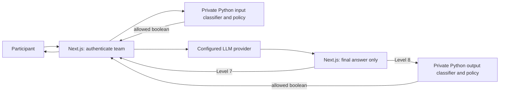

# Level 7/8 classifier deployment plan

## Current Next.js deployment

The Python pretrained-classifier bridge is now implemented and called by the
Next.js server for Levels 7 and 8. The main application still owns authentication,
team identity, flag derivation, system prompts, LLM calls, persistence and scoring.
No model weights or classifier thresholds have changed. The configured LLM may be
OpenAI-compatible or Qwen/Ollama; it is independent of the CPU classifiers.



`security.classifier_service` runs in its own Python process, loads the unchanged
pinned CPU input and output models at startup, and shares its input engine across
Levels 7 and 8. `apps/web/src/server/ml-classifiers.ts` authenticates private calls
with a server-only bearer token. The model service returns **only `{allowed: bool}`**;
Next.js never forwards classifier internals to participants. The service accepts
only known routes and bounded JSON. It has at most eight transport threads; model
runners retain their single admission slot and fail closed on busy/error/timeout.

| Internal endpoint | Request | Result |
| --- | --- | --- |
| `GET /health` | Bearer authorization | `{ready: bool}`; 503 when not ready |
| `POST /classify-input` | `{challenge_id: 7 or 8, message: string}` | `{allowed: bool}` |
| `POST /classify-output` | `{challenge_id: 8, response: string, protected_flag: string}` | `{allowed: bool}` |

These endpoints are **not participant routes**. Defaults bind to `127.0.0.1:8091`.
Keep the service local or behind a private authenticated HTTPS proxy; this package
does not configure production TLS, public ingress, service orchestration or replicas.
The Next.js client permits HTTP only to loopback hosts, rejects endpoint credentials/
query/fragment, disables redirects/cache, bounds response size, and times out after
35 seconds. Failure returns a sanitized 503; there is no generative-judge/mock fallback.

The output request contains only the current team's flag, derived by the authenticated
backend's existing `flagFor`. The service validates flag syntax and creates an ephemeral
trusted request context, but never derives, persists, returns or logs a flag. The
master `FLAG_SECRET` remains with Next.js. Participant JSON cannot choose a flag or
trusted team identity. The native Python `FlagService` uses its own documented
scheme; **do not substitute its derivation for Next.js scoring**.

### Start the complete local application

Install Node/pnpm and Python dependencies using the root README and the portable
commands below. Keep application settings in root `.env`. Copy `security/.env.example`
to private `security/.env`; configure one random >=32-byte `CRYPTUM_CLASSIFIER_TOKEN`
identically in both files. Use your secret manager; do not commit it or rotate it on
restart. The root `.env.example` documents `CRYPTUM_CLASSIFIER_URL` and the token.
The Python service needs no database, LLM API key, flag master key, or production flag.

```text
pnpm install --frozen-lockfile
uv sync --locked --python 3.12 --extra ml --extra dev --extra openai
uv run --no-sync python -m security.deploy prepare --env-file security/.env --timeout 600
pnpm db:migrate
pnpm db:seed
```

Run in separate terminals, using the intended development database only:

```text
uv run --no-sync python -m security.classifier_service --env-file security/.env
pnpm dev
```

After caching, set `HF_HUB_OFFLINE=1` in `security/.env`. Open the URL matching
`BETTER_AUTH_URL` exactly, normally **http://localhost:3000**. Visiting `127.0.0.1`
while that variable says `localhost` causes mutation requests to fail the existing
same-origin checks. Restart Next.js after adding server environment settings.

For a production build, use `pnpm build` then `pnpm start`, while running the Python
bridge as a separately supervised private process. Hosting owns process supervision,
HTTPS, secrets and admission capacity. Team creation/account UI from `feat/dev` is now included in this checkout after
the local merge. The merged PostgreSQL integration suite passed all nine cases.
Real Google OAuth still needs interactive account verification and correct
registered callbacks. See [../CTF_TEST_REPORT.md](../CTF_TEST_REPORT.md)
for tested and unverified paths.

### Thinking-mode boundary

The native Ollama adapter sends `stream=false` and `think=false`, discards separate
thinking fields, and its pipeline rejects inline reasoning markers. The Next.js
OpenAI-compatible provider buffers the response, drops separate SDK reasoning, keeps
only text after a closing thinking block, and fails closed for unterminated reasoning
or unexpected SSE/NDJSON. Its Qwen3-only soft `/no_think` control is not applied to
OpenAI models. It is a request hint, not a guarantee of confidentiality or of no
internal reasoning. Classifiers inspect participant input and deliverable final text;
unreturned reasoning is discarded before output classification. Real observations
and source references are in the test report.

## Native Python lifecycle API (alternative integration)

The remaining sections document `SecurityRuntime`, the optional native Python
orchestration interface. **It is not the path used by the Next.js classifier bridge.**
It still supports direct Python backends and injected Ollama or OpenAI clients, with its own
flag/context authority. The bridge above was added during full-application QA to
connect the existing Next.js flow without replacing its scoring or other levels.

## Exact models and preserved behavior

| Use | Pretrained model | Immutable revision |
| --- | --- | --- |
| Input, both levels | `protectai/deberta-v3-base-prompt-injection-v2` | `90c9989b1a342275dd0d1a95aad283c04e075671` |
| Output, Level 8 | `cross-encoder/nli-MiniLM2-L6-H768` | `b95119ce93d3e065de6214e38cd4a97b0f2f2c6d` |

Both use unchanged safetensors weights, `trust_remote_code=False`, CPU FP32,
`eval()` and `torch.inference_mode()`. No training, fine-tuning, conversion or
quantization occurs. The output model is the existing **zero-shot NLI strategy**,
not a model fine-tuned for secret leakage. Its limitations and supplementary exact/
encoded checks remain unchanged. Scores are not calibrated probabilities.

The input thresholds remain **0.75 (Level 7)** and **0.80 (Level 8)**; Level 8 output
remains **0.75**. Existing actions, protected prompt text, HMAC derivation, rotation,
case-sensitive `cdx{...}` format, context bindings, and thinking-field exclusion
are preserved. Deployment readiness does not establish classifier robustness or
competition solvability.

## Lifecycle and failure contract

1. Construct `SecurityRuntime` once, after trusted environment loading. Construction
   does not load weights. It rejects incompatible per-level input model identities.
2. Await `start(startup_timeout=300.0)` during Python security-worker startup, before admitting
   requests. It validates required Level 7/8 secrets, configures torch CPU threads,
   allocates two owned model runners, loads the pinned cached artifacts (downloads
   are possible unless offline), and performs real classifier warm-up on fixed
   nonsecret text to check model labels and scores. It then checks Ollama `/api/tags`
   for each configured model. It does not send flags or participant prompts to Qwen
   during preflight. The 300-second startup deadline is separate from unchanged
   30-second request classifier and 120-second Qwen deadlines.
3. Levels 7 and 8 use different classifier wrappers/policies referencing the **same
   input runner/engine**. There are only two loaded classifier engines per runtime.
   Existing low-level lazy `SecurityPipeline` callers remain supported, but should
   use this managed path for deployment. Do not mix both lifecycle paths in one
   worker: the legacy global cache and managed owned runners have separate ownership.
4. `health()` returns fixed operator metadata: lifecycle state, readiness, classifier
   states and whether startup Ollama preflight passed. It neither loads models nor
   performs network traffic. Keep this private to backend health supervision.
   Readiness is false while new/loading/failed/stopping/closed, or after a classifier
   error until successful re-warm/classification. It is a snapshot, not proof Qwen
   is still reachable or that a classifier slot is idle. Liveness is the backend
   process's responsibility. After errors, explicit `start()` can re-warm/recheck;
   it is idempotent when healthy. Ordinary transient inference errors can recover
   on the next request; no permissive fallback or automatic unguarded retry exists.
5. `handle(level, authenticated_team_id, message)` mints and validates a fresh trusted
   context internally and calls the existing pipeline. While not started/ready,
   it returns a sanitized `error/security_unavailable` without calling Qwen.
6. Each runner has a single native worker and a nonblocking admission slot. Its
   initialization and scoring never run concurrently on the same engine. A second
   simultaneous input call fails closed rather than creating an unbounded queue;
   Qwen requests already past input can overlap. Input and output engines can run
   independently. The backend must apply bounded request admission/rate limits and
   decide client retry responses; this module does not implement a scheduler.
7. Request and startup timeouts bound the **await**, not native torch execution.
   Timed-out/cancelled work keeps its slot until finished. Busy/failure results never
   skip classification. Failed initialization can be retried after the worker exits.
   If native execution hangs permanently, the worker supervisor must restart the
   worker. Python threads cannot safely force-kill it. See the
   [Python executor shutdown contract](https://docs.python.org/3.12/library/concurrent.futures.html#concurrent.futures.Executor.shutdown).
8. Await `aclose()` in the same event loop: stop admission, drain accepted requests,
   join owned classifier workers off the event loop, and release model references.
   Then close the Python-worker-owned HTTP client. Repeated close is safe; cancellation
   of a shutdown waiter does not cancel cleanup. Closed runtimes cannot restart;
   create a new instance. Shutdown can wait for request deadlines or native work;
   set an external supervisor deadline. RSS need not immediately return to baseline
   because native allocators may retain memory. No model is initialized before fork:
   initialize each worker after process creation.

| Failure | Server behavior | Participant boundary |
| --- | --- | --- |
| Missing/invalid master secret or Level 7 flag | Startup fails; no model request accepted | No protected data |
| Missing dependencies/weights, label mismatch, corrupt cache | Sanitized startup failure; readiness false | Fixed unavailable result |
| Ollama missing/model absent | Startup fails; fix runtime/model and explicitly retry | No provider exception/body |
| Still loading, shutting down or closed | No request admission | `error/security_unavailable` |
| Classifier busy/timeout/error/invalid score | Existing pipeline fails closed at that stage | `error/input_failed` or `error/output_failed` |
| Qwen error, timeout, malformed output or exposed thinking markers | Existing inference stage fails closed | `error/inference_failed` |
| Input/output policy block | Do not call Qwen / do not deliver generated content | Fixed refusal and stage code |

Model and HTTP debug/body tracing must remain off for secret-bearing requests.
The event sink only receives existing safe challenge/stage/outcome/elapsed metadata.
Neither health output nor participant results include scores, model internals,
system prompts, flags, team IDs or upstream exception messages. An allowed CTF
response is still the challenge model's text; intentionally imperfect defenses do
not guarantee it contains no confidential information.

## Integration contract for the backend/hosting team

[examples/backend_integration.py](examples/backend_integration.py) demonstrates the
**Python side** of a future private transport wrapper. These helpers are executable
Python interfaces, not Next.js code or implemented HTTP endpoints. Creating that
wrapper and wiring Next.js are external integration dependencies for this package.

```python
from security.examples.backend_integration import (
    participant_message, start_security, stop_security,
)

# Python security-worker startup, once per process; trusted env already injected:
runtime, http = await start_security()

# Inside the future Python transport wrapper, AFTER authenticating the backend:
result = await participant_message(
    runtime,
    authenticated_team_id=verified_backend_identity.team_id,
    level=validated_request.level,       # Only 7/8 accepted.
    message=validated_request.message,   # Plain user text, not a role/message list.
)
# Only serialize result: {"status": "allowed|blocked|error", "response": str, "code": str}.

# Future private flag-verification integration; no public derivation endpoint:
valid = runtime.validate_team_flag(
    verified_backend_identity.team_id, 8, validated_submission.submitted_flag,
)
# Authentication, submission persistence and scoring remain backend responsibilities.

# Python security-worker shutdown, after stopping ingress:
await stop_security(runtime, http)
```

A participant must never choose the authenticated identity, context, policy, model,
inference client, flag or template. `handle()` creates the trusted context internally.
The runtime's verifier and prompt authority use the same `FlagService`, rotation and
master key. Every replica must receive the same trusted master secret and rotation
to keep team flags stable. Do not rotate keys at worker restart. The Python interface
is a trusted internal boundary; it does not authenticate HTTP callers on its own.

The integration wrapper needs strict request/response validation, authenticated private
transport, bounded admission, readiness/lifecycle hooks and deadlines. It should return
only the sanitized result to Next.js and never return raw classifier scores, context,
system prompts or provider errors. Service URLs/credentials must remain server-side.
These are requirements for the integration team, not implemented transport guarantees.

If adapting the hosting team's inference client, implement `generate(messages,
config) -> InferenceResponse` plus `check_available(model) -> None` for startup
preflight. Discard reasoning/provider metadata and return only buffered participant
content. Existing `InferenceClient`/`SecurityPipeline` interfaces are unchanged.
Application-owned HTTP clients may supply private proxy authentication headers.
Keep credentials out of endpoint URLs. Bundled `OllamaClient` and official-SDK
`OpenAIClient` implement the same interface. `create_inference_client(http)` chooses
the provider from `LLM_PROVIDER`; see the provider deployment section below.

## Reproducible fresh-host setup

Supported application Python: **3.11 or 3.12**, with 3.12 used for real local tests.
Use Linux x86_64 (Ubuntu/Debian, Fedora, Arch) or native Apple Silicon macOS where
pinned dependency wheels are available. No CUDA, NVIDIA driver, shell activation
or Docker is required. Intel macOS has no official pinned torch 2.9.1 wheels; see
[PORTABILITY_REPORT.md](PORTABILITY_REPORT.md). Other architectures are not certified.

Install host bootstrap tools, choosing the one command matching the operating system:

```text
# Ubuntu / Debian
sudo apt update
sudo apt install git python3 python3-venv python3-pip
# Fedora
sudo dnf install git python3 python3-pip
# Arch
sudo pacman -S --needed git python python-pip
# Apple Silicon macOS with Homebrew
brew install git python
```

Then use the same commands on all these hosts; replace an existing clone step with
`cd` to your checkout. The guardrail deployment changes must be present in that checkout:

```text
git clone --branch llm-guardrails https://github.com/ayaankhatri/Codex-Cryptum-2026.git
cd Codex-Cryptum-2026
python3 -m venv .bootstrap
.bootstrap/bin/python -m pip install uv==0.13.1
.bootstrap/bin/uv python install 3.12
.bootstrap/bin/uv sync --locked --python 3.12 --extra ml
```

Use `.bootstrap/bin/uv` in place of `uv` below if uv is not otherwise installed.
`uv.lock` fixes transitive dependencies. Linux selects the CPU-only torch index;
Apple Silicon uses native PyPI CPU execution. Development/CI tools are optional:

```text
uv sync --locked --python 3.12 --extra ml --extra dev --extra openai
```

### Trusted environment and cache

Copy the example with a shell-independent Python command and edit `security/.env` privately:

```text
uv run --no-sync python -c "from pathlib import Path; import shutil; p=Path('security/.env'); assert not p.exists(), 'Refusing to overwrite security/.env'; shutil.copyfile('security/.env.example', p); p.chmod(0o600)"
```

Inject existing challenge secrets through the backend's secret manager or a private
server-owned `security/.env`; do not print production values or create new event keys on
restart. Replace the placeholders using trusted organizer configuration. Keep file
permissions restricted; `.env` is ignored by Git. The optional loader performs no
shell interpolation and existing process environment takes precedence.

The root `.env` can belong to Next.js and contain its database/auth/`LLM_*` settings.
Do not pass it to the strict Python guardrail loader. Use the separate
`security/.env` with only keys from `security/.env.example`. No automatic mapping of
backend `FLAG_SECRET` to `CRYPTUM_FLAG_MASTER_SECRET_HEX` exists: the team must agree
flag derivation/key ownership before connecting existing scoring. Copying a key alone
does not establish compatible derivation. No key or flag behavior is changed here.

| Variable | Required / value |
| --- | --- |
| `CRYPTUM_LEVEL7_FLAG` | Required: existing trusted Level 7 `cdx{...}` value |
| `CRYPTUM_FLAG_MASTER_SECRET_HEX` | Required for Level 8: existing random >=32-byte master key, hex-encoded |
| `CRYPTUM_FLAG_ROTATION` | Stable existing event epoch; default `2026-event-v1` |
| `OLLAMA_URL` | Trusted local `http://127.0.0.1:11434`, or private remote HTTPS endpoint |
| `OLLAMA_MODEL` | Existing `qwen3:8b`, or trusted hosting-team identifier |
| `CRYPTUM_CLASSIFIER_THREADS` | CPU intra-op threads 1–32; default 2, set before startup |
| `CRYPTUM_MODEL_CACHE` | Optional absolute or `~`-relative dedicated model cache, outside Git |
| `HF_HOME` | Optional Hugging Face cache root; framework defaults apply when omitted |
| `HF_HUB_OFFLINE` | Use `1` at runtime after preparation to prohibit Hub network access |

Set cache paths in `security/.env` before preparation, using the same file/path and OS user
for runtime. `CRYPTUM_MODEL_CACHE` takes priority for classifier artifacts when set;
`~` is expanded with pathlib. It is separate from core/venv package installation.
Do not set `HF_HUB_OFFLINE=1` until the artifacts are cached. Model preparation needs
only model/cache settings, not real flags or a master secret:

```text
uv run --no-sync python -m security.deploy prepare --env-file security/.env --timeout 600
```

This loads and validates the exact pinned tokenizer/model artifacts into CPU memory,
then closes the workers. It reuses the framework cache; it does not train weights or
pull Qwen. A slow download can exceed the deadline; resolve network/cache issues and
rerun preparation. To verify pre-provisioned caches without Hub network calls:

```text
uv run --no-sync python -m security.deploy prepare --env-file security/.env --offline
```

For air-gapped deployments, provision the same Hugging Face cache (including pinned
snapshot references, blobs and tokenizer files) on the target host, then run that
command there. See the [Transformers cache/offline documentation](https://huggingface.co/docs/transformers/v4.57.1/installation#offline-mode).
Do not copy an entire personal cache containing unrelated credentials.

### Local or remote Ollama

The hosting team installs Ollama, starts its server and provisions `qwen3:8b`.
If the model is already present, **do not pull it again**. On a development host,
these existing Ollama commands inspect availability:

```text
ollama list
# Only when Ollama is installed but not already managed/running:
ollama serve
# Only when the hosting team confirms the model is absent:
ollama pull qwen3:8b
```

`ollama serve` occupies its terminal; run checks from another terminal/backend process.
No systemd, launchd, GPU scheduling or production Ollama server is supplied here.
For local inference, retain `security/.env` defaults. For remote inference set
`OLLAMA_URL=https://your-private-inference-host/ollama` in the trusted environment;
use a reachable private endpoint configured by hosting. Qwen may use host-supported
GPU acceleration or CPU independently of the classifiers. Never expose Ollama to
participants. HTTPS/private networking, proxy authentication, access control and
certificates are hosting responsibilities. URL credentials/query/fragment are rejected.

### Startup, readiness and shutdown checks

After setting real trusted server config, run:

```text
uv run --no-sync python -m security.deploy check --env-file security/.env --offline
```

Success: exit 0 and JSON with `health.ready=true`, classifier states `ready`, and
`provider_preflight_passed=true`; only safe timing/resource metadata is included.
Failure: exit 2 with a fixed `SecurityError` code, never an upstream exception or
flag. This command **exits after closing its models**. It is a deployment preflight,
not a server and not a persistent warm-up for another process. The future Python
security-worker host must still await `runtime.start()` on its own runtime before routing traffic, publish
its private readiness result, and await `runtime.aclose()` at shutdown. If loading
explicit `.env` in backend code, call `load_environment_file(Path('security/.env'))` from
`security.runtime` before constructing the runtime. Do that before importing ML
libraries; HF offline/cache variables are read by those libraries during import.

Docker remains optional and no container orchestration is added. The classifier
bridge is a standalone private process; hosting can package it using the uv lock.

## Capacity, scaling and troubleshooting

The input/output weights are about 738/328 MB, roughly **1.1 GB of artifacts** total,
plus tokenizer/config/cache files. Resident RAM is larger due to torch, activation
buffers and Python. Reserve **at least 4 GB RAM and 2 CPU cores per security worker
as an initial sizing estimate**, then measure the actual traffic distribution; it
is not a throughput guarantee or a measured minimum. Every process/replica adds a
full model copy. Set CPU threads before warm-up and avoid multiplying worker count
without memory and oversubscription measurements. Qwen memory/VRAM and concurrency
are a separate hosting budget. See measured local results below.

| Symptom | Action without weakening security |
| --- | --- |
| `missing_master_secret`, `invalid_master_secret`, `missing_level7_flag` or startup failure | Fix trusted secret/flag placeholders and recheck; do not expose them in diagnostics |
| `model_preparation_failed` / startup fails offline | Confirm `ml` extra, correct CPU architecture, pinned cache revisions, complete files and read permissions; prepare online before setting offline mode |
| `invalid_configuration` or `classifier_unavailable` | Validate Python 3.11/3.12, CPU thread range, trusted YAML/model name and dependency installation |
| Startup fails after classifier warm-up | Check the hosting server and model availability with the existing adapter's `check_available`; ensure remote TLS/private connectivity |
| Many `input_failed` events under concurrency | Apply bounded ingress/backpressure in backend; measure before increasing replicas; never skip screening |
| Requests time out on CPU | Measure input length/CPU contention and Qwen host latency; fix resource allocation, retain existing policy deadlines/thresholds |
| Health false after transient classifier error | Explicitly retry `start()` after work completes, or restart the worker; never swap in demo classifiers |
| Shutdown remains pending | Native work may still be running; use supervisor deadline and restart at process boundary |

If later hosting the input model independently, implement the async `InputClassifier` protocol with
a private authenticated HTTP adapter, pinned service/model revision, bounded request
sizes, strict score/type validation, transport deadline and sanitized fail-closed
errors. The security pipeline should still apply its own policy. Never let participant
requests choose the service URL. Input screening needs participant text only; it does
not need any flag. Remote output classification would require a separately reviewed
trusted context/secret-handling contract. The current Next.js bridge contract is
documented above; a remote adapter for the native Python runtime is not supplied.

## Validation evidence and remaining integration work

Fast tests simulate ML dependencies and HTTP; real integration tests separately load
the pinned cached pretrained weights and use benign requests against actual local
Qwen. Run:

```text
uv run --no-sync python -m pytest -q -m "not integration"
uv run --no-sync ruff check security
uv run --no-sync ruff format --check security
uv build --wheel
```

For real tests without shell-specific assignments:

```text
uv run --no-sync python -c "import os, pytest; os.environ['HF_HUB_OFFLINE']='1'; os.environ['CRYPTUM_RUN_REAL_INTEGRATION']='1'; raise SystemExit(pytest.main(['-q']))"
```

These tests create synthetic authorities/teams. They do not use production flag
configuration or search for new extraction exploits. Local deployment measurements
and final test counts are recorded below after validation. Cross-platform CI for
this deployment follow-up was not run during local validation; earlier PR #3 portability CI passed all
six Linux/macOS jobs, but did not run real model weights on macOS.

Implemented: in-process lifecycle, warm-up, shared input weights, safe health snapshot,
bounded classifier workers, context-minting backend contract, flag verifier, preflight
CLI, deployment tests and setup documentation. The current web deployment also has
the private classifier transport, Next.js client, DTO validation and readiness route
described above. Hosting must still provide supervision, bounded public admission,
secret injection and lifecycle integration.
Jiya owns backend authentication, scoring and persistence. Awaiting hosting: Qwen
endpoint, runtime availability, production supervision, resource sizing and remote
network controls. Awaiting organizers: final deployment worker count/host and event
secret provisioning; provisional challenge thresholds remain unchanged.

### Measured results for this rework

Host: Arch Linux x86_64, Linux 6.18.56, Python 3.12.14; uv 0.13.1. Existing local
Ollama `/api/tags` returned 200 and included `qwen3:8b`. The tests used synthetic
team identities/development flags and an independent synthetic master key.

| Check | Actual result |
| --- | --- |
| Before changes, default suite | 208 passed, 11 real integration cases skipped |
| New deployment test module, simulated ML dependencies | 34 passed, 0 failed (1.02 s) |
| Full Python 3.12 suite, offline cached real classifiers and local Ollama enabled | **254 passed, 0 failed, 0 skipped** (34.99 s); includes 12 real integration cases |
| Python 3.11.16 core/QA environment with no torch installed | **242 passed**, 12 real cases deselected, 0 failed (2.87 s) |
| Real offline `security.deploy prepare` | Exit 0, both pinned models loaded/validated and closed; 6.16 s |
| Real offline `security.deploy check`, synthetic trusted environment | Exit 0; both model states ready, Ollama preflight passed; 8.43 s |
| Preflight process resident memory snapshot | 1,028,329,472 bytes, approximately **981 MiB** RSS; not an activation-peak guarantee |
| Wheel build and content inspection | Passed; new deployment modules included, no weights or `.env` |
| Ruff lint/format, locked dependency resolution, whitespace checks | Passed |

The new real managed-runtime case starts the real CPU models, verifies input engine
identity across levels, executes benign Level 7 and Level 8 requests for two teams
through actual Qwen, checks model reuse/flag suppression, then closes the runtime.
Existing real cases also verify blocked fixture inputs never reach inference and
fixture outputs containing synthetic team flags never reach participants. Those
secret-bearing **output fixtures use simulated Qwen content with real classifiers**;
they are not evidence of Qwen extraction exploits. Full-suite real integration is
opt-in so ordinary CI remains weight-free.

SentencePiece/SWIG emitted two upstream deprecation warnings in the real pytest run
(and an exit-time SWIG warning). Preparation emitted tokenizer performance notices;
none failed validation. The GPU instrument observed 6,074 MiB in use on an 8,188 MiB
RTX 4060 Laptop GPU at preflight, but it is a **global** reading including Qwen and
other host activity, not classifier VRAM. Classifier parameters were asserted on CPU.
No throughput, production load, fresh online download or remote Qwen benchmark was
performed. Offline preparation reused existing artifacts without redownloading them.

### Integration status

The Python classifier HTTP bridge and Next.js server-only client are implemented and
were tested together against the real cached classifiers and configured OpenAI model.
The earlier native-Python example remains supported. Team creation and Level 3/9
feature branches are not merged by this work. Production hosting, genuine Google
OAuth and challenge solvability approval remain external requirements. No commit,
push, merge or deployment was performed during this QA follow-up.

## Native Python OpenAI deployment

The alternative native Python `SecurityRuntime` can now use either bundled provider.
This does not reroute the Next.js application's existing `LLM_*` integration, change
its flags, or move authentication into Python. The current Next.js flow above keeps
using its private pretrained-classifier bridge. For native Python deployments:

1. Install `uv sync --locked --python 3.12 --extra ml --extra dev --extra openai`.
2. Copy `security/.env.example` to `security/.env`. Supply the existing native-runtime
   trusted flag/master configuration. Select `LLM_PROVIDER=openai`, set an explicit
   `OPENAI_MODEL` and server-side `OPENAI_API_KEY`. Keep this file private.
3. Prepare cached weights using `python -m security.deploy prepare` under the uv
   environment, then run the check below. Model weights/revisions are unchanged.
4. Start the existing host integration once per worker using
   `security.examples.backend_integration.start_security()`. Its factory selects the
   provider before runtime startup. Drain with `stop_security()` on shutdown.

```text
uv run --no-sync python -m security.deploy prepare --env-file security/.env --timeout 600
uv run --no-sync python -m security.deploy check --env-file security/.env --offline
uv run --no-sync python -m security --provider openai --env-file security/.env
```

For Ollama, select `LLM_PROVIDER=ollama` instead, retain `OLLAMA_MODEL=qwen3:8b`, and
set `OLLAMA_URL` to the local or trusted remote server. The same `check` command and
backend interface work; `--provider ollama` runs the live demo. No OpenAI key or SDK
is required for Ollama-only deployments.

The SDK is pinned at 2.29.0 for the existing HTTPX transport. Only one selected
client is constructed and reused. Its transport belongs to the host and closes after
the security runtime drains. Startup validates credentials/model/settings and probes
the provider's models endpoint. Failed preflight leaves readiness false; unavailable
providers never trigger a fallback. `RuntimeHealth.provider_preflight_passed` is the
provider-neutral alias; `ollama_preflight_passed` remains for backwards compatibility
and now represents the selected provider's preflight. `security.deploy check` prints
both names without any protected context.

OpenAI operation timeout defaults to 60 seconds, capped by the existing challenge
request deadline. SDK retries default to one and are limited to at most two; they
remain inside the deadline. See [provider parameters](README.md#provider-parameters-and-failure-behavior)
for model-specific token and reasoning settings. Missing SDK, invalid settings,
model access failures, exhausted rate limits/timeouts, malformed responses and
unexpected streams fail closed with fixed codes. Do not enable SDK debug logs.
Remote OpenAI-compatible bases require HTTPS. Proxies must implement nonstreamed
Chat Completions and model retrieval; support for arbitrary providers is not claimed.

Level 7 still screens input with the pinned CPU DeBERTa; Level 8 adds the unchanged
output classifier before delivery. The exact same system/context builder runs for
both LLM providers. Qwen-specific controls stay in Ollama, and OpenAI exposes only
assistant final content. Model weights, flag derivation and thresholds are unchanged.
See [../CTF_TEST_REPORT.md](../CTF_TEST_REPORT.md) for actual validation evidence.
